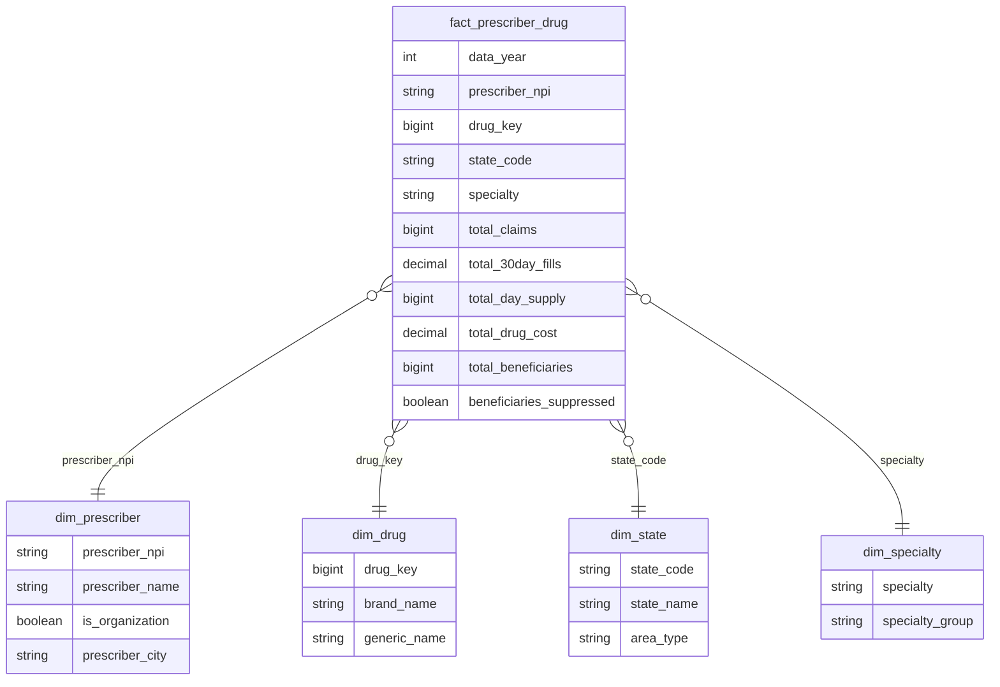

# Medicare Part D Prescriber Pipeline (Databricks)

A bronze/silver/gold lakehouse pipeline built on CMS's **Medicare Part D Prescribers by Provider and Drug** data (data year 2024), ending in a star schema for Power BI.

The gold fact table holds **28,023,892 rows** (one per prescriber, drug, and year), and its total drug cost of **$226,740,902,130.59** reconciles to the silver layer to the cent. CMS excludes prescriber-drug pairs with fewer than 11 claims, so totals cover reported prescribing only, not all Part D spending. Every layer is guarded by assertions that stop the pipeline instead of letting a bad table through.

**Stack:** Databricks Free Edition, Unity Catalog, Delta Lake, PySpark, SQL. Power BI reporting is in progress.

---

## Pipeline

| Notebook | Layer | What it does |
| --- | --- | --- |
| `01_setup` | Setup | Creates the `cms` catalog, the `bronze` / `silver` / `gold` schemas, and a volume for the raw CSV. |
| `02_bronze_load` | Bronze | Loads the CSV into a Delta table (491 MB) as-is, with lineage columns. |
| `03_profile_bronze` | Bronze | Profiles the raw data in SQL and PySpark. The results drive every silver decision. |
| `04_silver` | Silver | Types and renames columns per the CMS data dictionary, decodes suppression flags, and checks the result. |
| `05_reference` | Silver | Builds state and specialty lookup tables, each with its own checks. |
| `06_gold` | Gold | Builds the star schema and reconciles it back to silver. |

Run the notebooks in order (`03_profile_bronze` is exploratory and can be skipped). The pipeline currently loads one data year, 2024. `data_year` is taken from the filename and carried through to the gold grain, so the schema is ready for multiple years, but the loader would need to read all files in the volume instead of a single named file.

---

## Gold star schema

- **Grain:** one fact row per data year × prescriber × drug.
- **Drug key:** a deterministic `xxhash64` of brand name and generic name. Because of that, the fact table computes its key without joining to `dim_drug`. Uniqueness is verified, so there are no hash collisions across the 3,159 drug pairs.
- **The 65+ columns are deliberately left out of gold.** They stay in silver, but they are suppressed too heavily to report on (see below).

---

## Data quality gates

Each check is an `assert`, so a failure stops the run.

| Layer | Check |
| --- | --- |
| Bronze | The file header matches the expected 22 columns exactly. No row is malformed: rows that fail to parse are captured in `_corrupt_record` and fail the run. |
| Silver | The row count matches bronze. No row falls under CMS's 11-claim floor. 30-day fills sit between claims and 12× claims. Each suppression flag agrees with whether its value is NULL. No NULL keys. |
| Reference | One row per state code and per specialty. Every state code in the data maps to the lookup. Every hand-listed dental specialty exists in the data. Any dental-sounding label nobody has reviewed raises an alarm. |
| Gold | Every dimension has unique keys (a duplicate would double-count cost in Power BI). No fact row is missing its dimension (it would show up as "(Blank)"). The grain is unique. Total drug cost matches silver to the cent. |

---

## What the data revealed

- **Suppression drives the metric choice.** CMS hides counts between 1 and 10. Total beneficiaries are suppressed on 54.5% of rows. For ages 65+, beneficiary counts are hidden on 88% and claim totals on 44%. The analysis is therefore built on claims and cost, which are never suppressed.
- **Suppressed means NULL, never 0.** Silver keeps hidden values as NULL and records why they were hidden: either the value itself is 1 to 10 (`*`), or the hidden under-65 portion is 1 to 10, so showing the 65+ value would let anyone work it out by subtraction (`#`).
- **The data dictionary contradicted itself** about which flag controls which 65+ field. Querying the data settled it: `GE65_Sprsn_Flag` governs 65+ claims, cost, and days' supply, and `GE65_Bene_Sprsn_Flag` governs the 65+ beneficiary count. This is now enforced by an assertion in silver.
- **Pattern matching failed in both directions.** `LIKE '%dent%'` matched "Student" and "Independent", and `'%oral%'` matched "Behavioral". It also missed Prosthodontics, Periodontics, and Maxillofacial Surgery. Dental membership is now an explicit, reviewed list of 15 labels, with a broader-pattern alarm that fails on any dental-looking label nobody has reviewed. That alarm caught the three misses.
- **A state code was missing from the lookup.** The join-coverage check failed on `FM`, the Federated States of Micronesia. It is a freely associated state where U.S. postal codes and some federal programs apply. The lookup now covers every code CMS documents plus the three freely associated states (Micronesia, the Marshall Islands, Palau), not just the codes that appear in this year's data.
- **A NULL specialty created an empty lookup entry**, since `SELECT DISTINCT` keeps NULL as a value and a NULL key never joins. Silver now fills it with `'Not Reported'`.
- **Some FIPS codes aren't numeric** (`9A` through `9E`), so `state_fips` stays a string.

---

## Next

- Connect Power BI to the gold schema.
- Extend the bronze loader to ingest multiple data years.

**Sources:**
- Data: [CMS Medicare Part D Prescribers by Provider and Drug](https://data.cms.gov/provider-summary-by-type-of-service/medicare-part-d-prescribers/medicare-part-d-prescribers-by-provider-and-drug)
- Data dictionary: [link]
- Methodology (suppression flags and state codes): [link]
